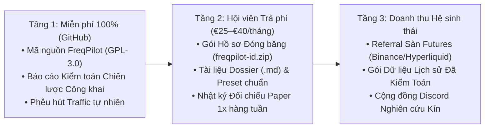

# Kế hoạch Định vị Thương hiệu & Chiến lược Tăng trưởng (Brand & GTM Playbook) — FreqPilot

Tài liệu này xác lập định vị thương hiệu, kiến trúc sản phẩm 3 tầng và chiến lược thu hút lưu lượng truy cập tự nhiên (Organic Traffic) từ GitHub, các cộng đồng giao dịch định lượng (Quant/Algo Trading) và hệ thống quét chiến lược tự động.

---

## 1. Định vị Thương hiệu (Brand Positioning & Category Design)

### 1.1. Bối cảnh thị trường & Khoảng trống (The Market Gap)
Thị trường công cụ và nội dung giao dịch thuật toán crypto hiện bị chia cắt thành hai thái cực lỗi:
1. **Nhóm "Bánh vẽ / Curve-Fitting Theater"**: Khoe ảnh chụp backtest lãi hàng trăm phần trăm nhưng giấu mã nguồn, không tính phí funding 8h, dính lỗi nhìn tương lai (`lookahead bias`), tối ưu quá khớp (`overfitting`) trên toàn tập dữ liệu và chỉ chọn đúng 1 tháng thuận lợi để quảng bá.
2. **Nhóm "Công cụ rời rạc hoặc ép dùng bản Fork"**:
   - Freqtrade gốc rất mạnh nhưng người dùng phải gõ lệnh CLI rời rạc cho từng bước (backtest, lookahead, recursive, hyperopt) và tự quản lý file kết quả.
   - `frequi-ultimate` có giao diện đẹp nhưng khóa cứng tính năng `/strategy-dev` vào bản fork `freqtrade-ultimate` (trả về lỗi `404` trên Freqtrade chính thức) và dùng các chỉ số tự chế dễ gây hiểu lầm (như chia `WFE` qua 0).

### 1.2. Tuyên ngôn Định vị của FreqPilot (Positioning Statement)
> **FreqPilot là Phòng Thí Nghiệm Định Lượng Trung Thực (Evidence-First Quant Studio) dành cho người dùng Freqtrade chính thức — nơi mọi ý tưởng chiến lược phải vượt qua kiểm toán dữ liệu, kiểm định Lookahead/Recursive, Ma trận Độ nhạy 2D, Walk-Forward Holdout niêm phong và Đối chiếu Paper 1x thực tế kèm dấu vân tay `SHA-256`.**

### 1.3. Ba Trụ cột Thương hiệu (Core Brand Pillars)
| Trụ cột | Thông điệp cốt lõi | Bằng chứng kỹ thuật trong sản phẩm |
| :--- | :--- | :--- |
| **1. Zero-Fork Official Engine** | *"Không đánh đổi sự ổn định của bot lấy giao diện."* | Chạy 100% trên **Freqtrade `2026.9` chính thức**; không sửa 1 dòng nào trong 118 tệp lõi của engine. |
| **2. Cryptographic Provenance (`SHA-256`)** | *"Đừng tin lời kể — hãy kiểm tra gói đóng băng."* | Mỗi kết quả là một gói `freqpilot-<id>.zip` chứa mã `.py`, `preset`, nến/mark/funding và `artifact_sha256` để bất kỳ ai cũng nạp lại (`Import .zip`) và kiểm chứng được. |
| **3. Anti-Overfit Discipline** | *"Công bố cả chiến lược sụp đổ trên OOS & Holdout."* | Luôn giữ **Baseline không tối ưu** cạnh ứng viên Hyperopt trên Holdout niêm phong; cảnh báo mẫu nhỏ (`< 30 lệnh`) và không gán dữ liệu thiếu bằng `0`. |

---

## 2. Kiến trúc Sản phẩm & Mô hình Doanh thu 3 Tầng (Open-Core + Dossier Membership)

Học hỏi trực tiếp từ mô hình thành công của `freqtrade_france` (€40/tháng trên BuyMeACoffee) nhưng nâng cấp bằng hạ tầng kỹ thuật đóng gói tự động của FreqPilot:

### Tại sao Hội viên sẵn sàng trả phí định kỳ dù công cụ FreqPilot mở mã nguồn?
- Phần mềm (`FreqPilot`) là **đầu đọc đĩa (Player)** — mở miễn phí để càng nhiều người cài càng tốt.
- **Các gói Hồ sơ Chiến lược đã qua thẩm định (`freqpilot-<id>.zip` + `Dossier .md`) và Nhật ký Paper 1x hàng tuần** là **đĩa nhạc chất lượng cao (Verified Content)** — thứ tốn hàng trăm giờ quét, lọc nhiễu, kiểm tra Lookahead, chạy 6,7 tháng `5m` và theo dõi Paper 1x liên tục.
- Người dùng đã cài FreqPilot chỉ mất **5 giây** để bấm **`Nhập gói hồ sơ (.zip)`** trong bước `04 · Backtest` và có ngay toàn bộ chiến lược, dữ liệu đóng băng và báo cáo của bạn trên máy họ.

---

## 3. Cỗ máy Sản xuất Nội dung từ Hệ thống Quét Tự động (The Content Flywheel)

Bạn đang có một "mỏ vàng" nội dung mà không đối thủ nào có: **Hệ thống quét `CryptoResearch` (`127.0.0.1:8880`) đã thu thập 920+ hồ sơ chiến lược từ GitHub, Substack, HAL, Zenodo, OSF và chạy 177+ job kiểm định**.

Mỗi tuần, vận hành đúng 1 vòng lặp 3 bài đăng (tốn ~1 giờ xuất dữ liệu từ FreqPilot):

### Định dạng 1: "Giải phẫu Chiến lược GitHub" (Thu hút 80% Traffic đầu phễu)
- **Tiêu đề mẫu**: *"Tôi đã quét 177 chiến lược Crypto trên GitHub bằng dữ liệu Funding & nến 5m thật: Tại sao 90% sụp đổ và 3 chiến lược nào sống sót?"*
- **Nội dung**:
  - Đưa số liệu thực tế từ `docs/SCANNED-STRATEGIES-TRIAL.md`: Ví dụ `CodexBotVibe4h` lãi `+3,30 USDT` trong 1 tháng cuối nhưng âm `-20,02 USDT` khi mở rộng ra 6,7 tháng.
  - Kèm ảnh chụp màn hình `UnderwaterChart`, `MonthlyReturnsHeatmap` và `ExitReasonChart` từ FreqPilot.
  - Dẫn link về repo GitHub của FreqPilot để người đọc tự tải công cụ về kiểm tra chiến lược của họ.

### Định dạng 2: "Cuộc chiến Chống Overfit: Mặc định vs Hyperopt trên Holdout Niêm phong" (Xây dựng uy tín chuyên gia)
- **Tiêu đề mẫu**: *"Tại sao tối ưu hóa Hyperopt lại làm giảm lợi nhuận thực tế? Bằng chứng từ cửa sổ Holdout niêm phong trên Freqtrade 2026.9."*
- **Nội dung**:
  - Dùng chính kết quả Walk-Forward `94b955e45b` và Ma trận Độ nhạy `d28b58b598` của `DikibagastEmaRsi1h`:
    - Cho xem ảnh chụp bảng **Ma trận Độ nhạy 2D `3×3`** (cả 9/9 ô đều xanh từ `+26 USDT` đến `+46 USDT`).
    - Cho xem ảnh chụp thẻ **Holdout niêm phong (`.holdout-grid`)**: Bộ tham số gốc không tối ưu (**Baseline**) thắng `+9,16 USDT (PF 3,44)`, trong khi ứng viên do Hyperopt chọn bị âm `-3,46 USDT`.
  - Bài học này chạm đúng nỗi đau mất tiền vì overfit của mọi trader dùng Freqtrade.

### Định dạng 3: "Nhật ký Đối chiếu Paper 1x vs Backtest" (Chuyển đổi thành Hội viên trả phí)
- **Tiêu đề mẫu**: *"Tuần X chạy Paper 1x Isolated chiến lược DikibagastEmaRsi1h: Khớp bao nhiêu % so với Backtest?"*
- **Nội dung**:
  - Xuất báo cáo từ `PaperReconcileWorkspace` (số lệnh khớp, số lệnh lệch do thời점 nến/funding).
  - Đính kèm tệp `freqpilot-<id>.zip` + `dossier-DikibagastEmaRsi1h.md` dành riêng cho Hội viên.

---

## 4. Chiến thuật Kéo Traffic từ GitHub & Các Kênh Hiện Có (90-Day Roadmap)

### Giai đoạn 1 (Tuần 1–2): Tối ưu hóa "Trạm Đón Traffic" trên GitHub
1. **GitHub Topics chuẩn SEO**: Gắn đủ các nhãn `freqtrade`, `frequi`, `algorithmic-trading`, `crypto-trading-bot`, `walk-forward-analysis`, `backtesting`, `quantitative-finance`, `binance-futures`.
2. **GitHub Social Preview**: Dùng ảnh ghép 2 màn hình đắt giá nhất của FreqPilot: **Ma trận Độ nhạy 2D (`9/9` ô xanh)** + **Đường vốn & Underwater Chart**.
3. **Liên kết chéo lịch sự (Ethical Cross-Linking)**:
   - Trong `docs/SCANNED-STRATEGIES-TRIAL.md` và `docs/FREQTRADE-FRANCE-TRIAL.md`, ghi nhận rõ nguồn gốc và dẫn link tới các repo gốc (`miraziz-Developer`, `BDR-Pro`, `accordgtsx-cyber`, `EnriqueCerv`, `frequi-ultimate`).
   - Khi chia sẻ kết quả kiểm định độc lập trong các mục Discussions/Issues kỹ thuật liên quan, lập trình viên quan tâm đến các repo đó sẽ tự nhiên tìm đến FreqPilot.

### Giai đoạn 2 (Tuần 3–6): Phát hành Chuỗi "Báo cáo Kiểm toán Chiến lược Mở"
1. **Reddit (`r/algotrading`, `r/freqtrade`)**:
   - Cộng đồng Reddit rất ghét bài quảng cáo bán hàng nhưng **cực kỳ yêu thích các bài Post-mortem có bảng số liệu thật và mã nguồn mở**.
   - Đăng bài phân tích kỹ thuật: *"We benchmarked 18 open-source crypto strategies on official Freqtrade 2026.9 with 1m/5m intrabar detail, funding rates, and sealed holdout WFA — here are the raw results"*.
2. **X (Twitter) & YouTube**:
   - Mỗi tuần 1 video ngắn (5–10 phút) quay trực tiếp trên màn hình FreqPilot `/studio`: từ lúc bấm lọc `#quét-tự-động`, mở Split-pane Editor, chạy kiểm định Lookahead, xem Ma trận Độ nhạy 2D đến lúc xuất Dossier `.md`.

### Giai đoạn 3 (Tuần 7–12): Mở Gói Hội viên "Verified Dossiers"
1. Mở trang Hội viên (BuyMeACoffee / Substack / LemonSqueezy) với quy tắc minh bạch 80/20:
   - **80% miễn phí**: Toàn bộ phần mềm FreqPilot + các bài phân tích lỗi sai & bảng xếp hạng tổng quan.
   - **20% dành cho Hội viên**: Kho tải trực tiếp các gói `freqpilot-<id>.zip` đã xác minh `SHA-256`, file `Preset` chuẩn, báo cáo `Dossier (.md)` chi tiết và quyền truy cập kênh đối chiếu Paper 1x hàng tuần.
